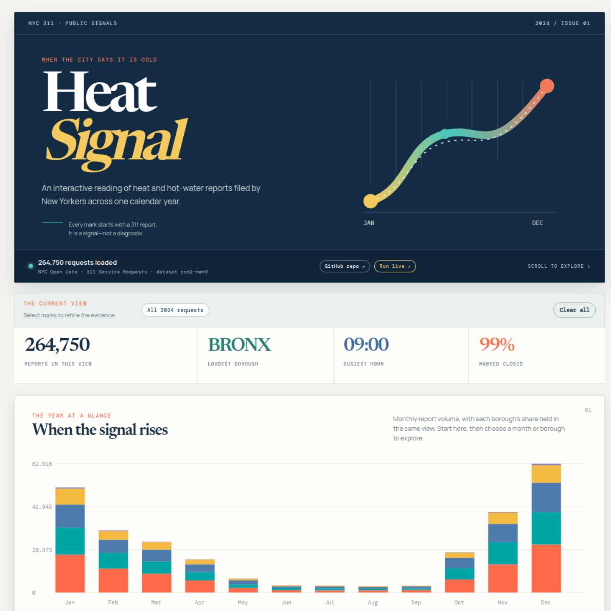
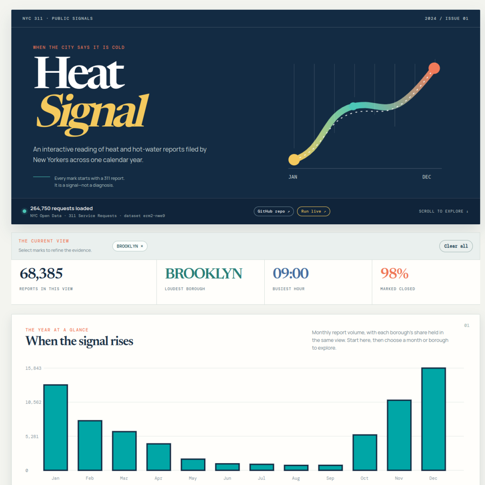
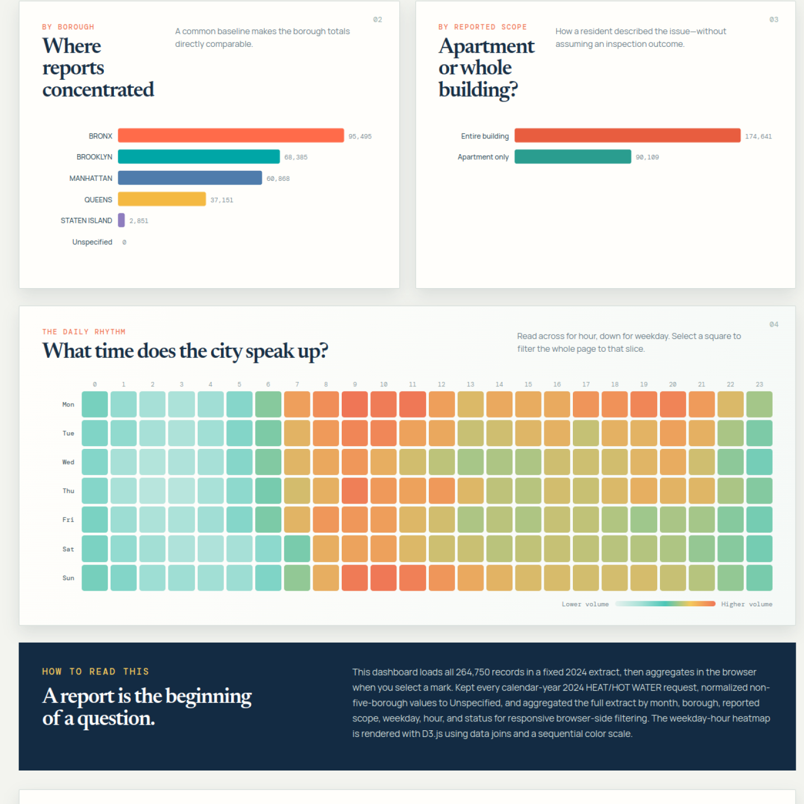
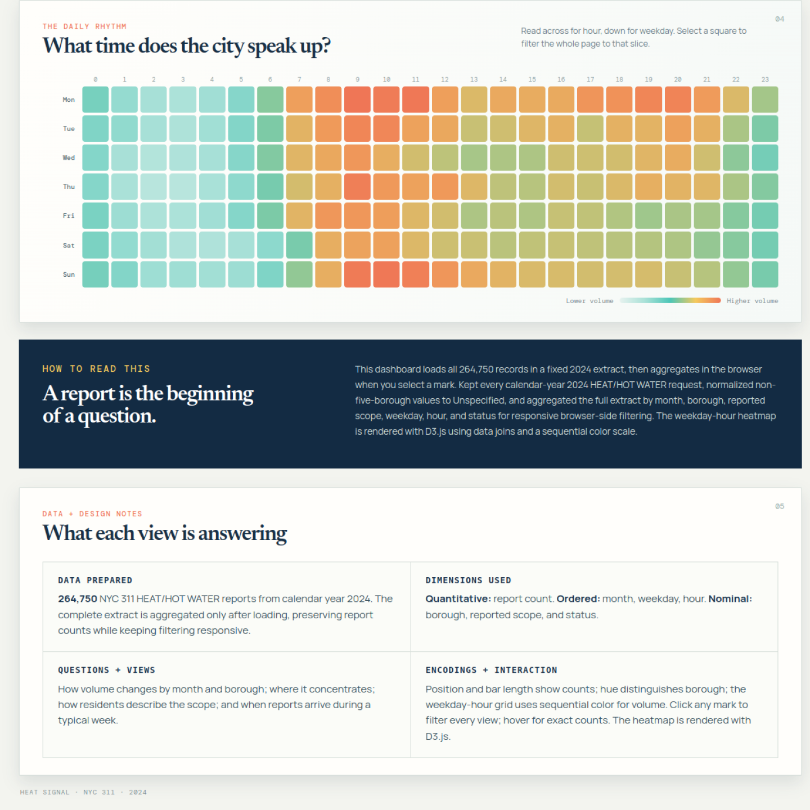

# Heat Signal

**Heat Signal** is an interactive field note on NYC 311 reports for heat and hot-water problems during 2024. It is a course prototype for Information Visualization.

> 311 reports are signals from residents, not verified heating failures, household prevalence, or borough risk.

## Live site

Once GitHub Pages finishes its first deployment, the dashboard will be available at:

`https://perumal100.github.io/Heat-Signal/`

## What it explores

1. How request volume differs by month and borough.
2. When reports concentrate by weekday and hour.
3. How reported scope differs between entire-building and apartment-only reports.

## Interaction

- Click a borough label, a month segment, a scope bar, or a weekday-hour cell to add a filter.
- Hover a mark for its exact request count.
- Use the filter chips or **Reset view** to remove selections.

## Prototype rubric evidence

| Criterion | Evidence in Heat Signal |
| --- | --- |
| Data loaded & prepared | The dashboard loads the full **264,750-record** 2024 NYC 311 HEAT/HOT WATER extract. `prepare_data.py` documents the source query, validates the record total, normalizes non-five-borough values, and creates the compact browser data cube. |
| Views implemented | Four real-data views address the stated questions: monthly stacked reports by borough, borough totals, reported scope totals, and a weekday-hour heatmap. |
| Encodings applied | Report count is encoded by bar length and sequential heatmap color; month, weekday, and hour use ordered position; borough uses color and category; reported scope and status are nominal categories. |
| Basic interaction & linking | Clicking a month, borough, scope, or weekday-hour cell filters the other views and summary metrics. Hover provides exact counts. The heatmap uses D3.js v7 data joins and a sequential color scale. |

The dashboard's on-page **Data + Design Notes** section repeats this information for a live demo.

## Data and preparation

The dashboard contains an exact compact data cube derived from the **264,750** NYC 311 `HEAT/HOT WATER` requests created in calendar year 2024. The source dataset is [NYC Open Data - 311 Service Requests from 2020 to Present](https://data.cityofnewyork.us/d/erm2-nwe9).

The interactive heatmap is rendered with **D3.js v7**, using D3's data joins and sequential color scale.

The original variables used are request ID, created date, borough, descriptor, status, and incident ZIP code. The prepared browser dataset preserves month, borough, reported scope, weekday, hour, and status. `prepare_data.py` is included for reproducibility and verifies the expected record total before writing the compact files in `dist/data/`.

## Run locally

Double-click `START_HEAT_SIGNAL.bat` on Windows, or run:

```powershell
python -m http.server 8000 --directory dist
```

Open [http://localhost:8000](http://localhost:8000). Keep the terminal running while you use the dashboard.

## GitHub Pages

The included workflow deploys the `dist/` folder whenever `main` changes. In GitHub, open **Settings → Pages** and set **Build and deployment** to **GitHub Actions** if it is not already selected.

## Submission screenshots

### Opening dashboard



### Cross-filtered dashboard



### Borough and reported-scope comparisons



### Weekday-hour heatmap and design notes


