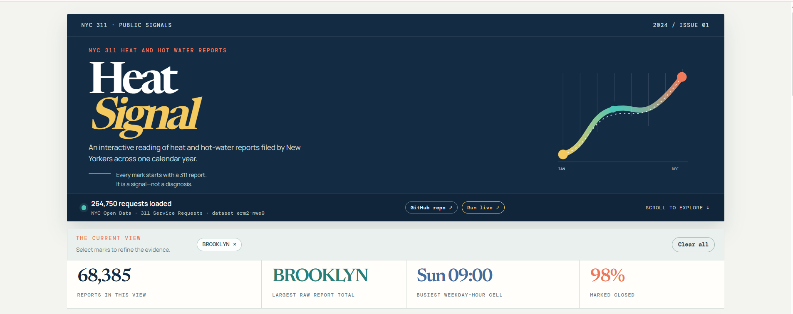
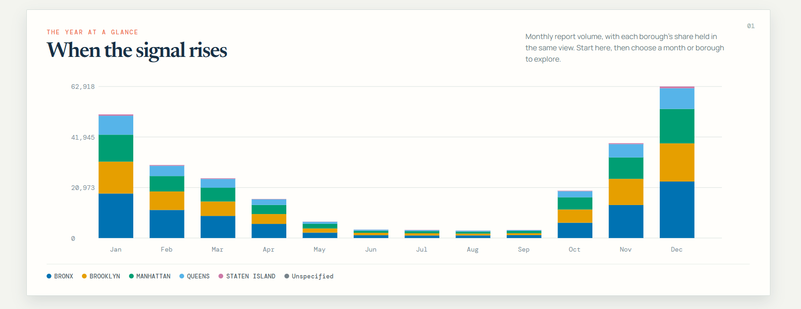
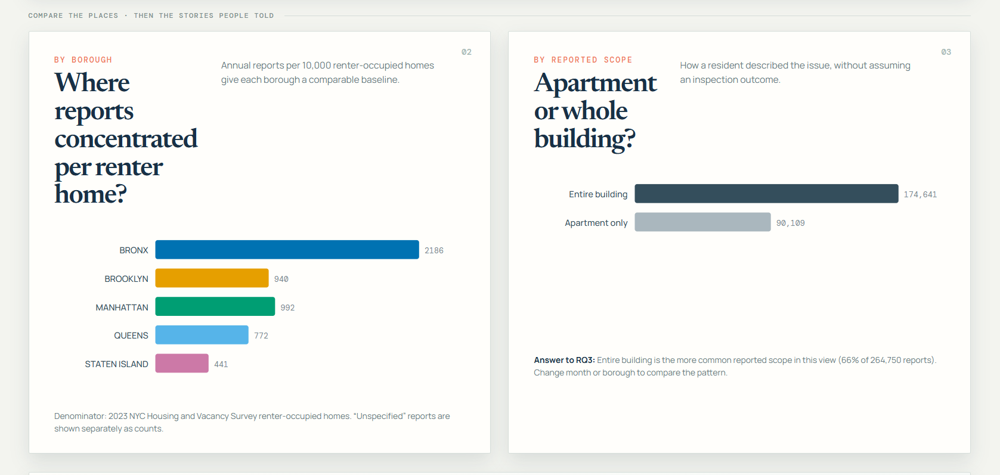
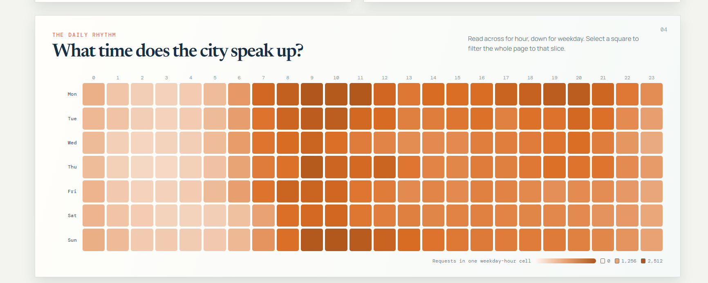

# Heat Signal

Heat Signal is an interactive dashboard about NYC 311 heat and hot water reports created during calendar year 2024. It treats each report as a public signal of a resident's experience, not as a diagnosis of building conditions or household risk.

## Live dashboard

[Open Heat Signal](https://perumal100.github.io/Heat-Signal/)

## Technical stack

| Requirement area | Implementation |
| --- | --- |
| Interactive dashboard tool | D3.js with HTML, CSS, and JavaScript |
| Public data source | NYC Open Data 311 Service Requests from 2020 to Present |
| Data preparation | Python `prepare_data.py` creates compact browser data files |
| Coordinated interaction | D3.js event handling and shared filter state |
| Online hosting | GitHub Pages |
| Deployment | GitHub Actions workflow publishing the `dist/` directory |

## Research questions

1. When do heat and hot water reports rise across the year?
2. Which boroughs have the highest report concentration after accounting for renter occupied homes?
3. Are residents more likely to report an apartment only issue or an entire building issue?

The dashboard answers these questions directly. The reported scope panel includes a plain language answer to the third question that updates with the active filters.

## Dashboard views and interaction

Heat Signal contains four coordinated views plus a shared KPI strip.

| View | Question answered | Main encodings | Interaction |
| --- | --- | --- | --- |
| Monthly reports by borough | When does reporting rise? | Ordered month position, bar length, borough hue | Select a month segment or borough |
| Reports per 10,000 renter occupied homes | Where are reports concentrated? | Ranked position and bar length | Select a borough |
| Reported scope | Apartment only or entire building? | Bar length and neutral gray category styling | Select a scope |
| Weekday by hour heatmap | When during the week do reports arrive? | Ordered weekday and hour position, sequential orange lightness | Select a weekday-hour cell |

Selecting a mark filters every other view and the KPI strip. Hovering reveals exact values. Active filters appear as chips and can be cleared with one control.

## Data and preparation

- Source: [NYC Open Data, 311 Service Requests from 2020 to Present](https://data.cityofnewyork.us/d/erm2-nwe9)
- Scope: 264,750 NYC 311 `HEAT/HOT WATER` requests created in 2024
- Prepared fields: month, borough, reported scope, weekday, hour, status, and request count
- Reproducibility: `prepare_data.py` validates the record total, standardizes borough values, and writes the compact data files used by the browser

The borough comparison is normalized as reports per 10,000 renter occupied homes using 2023 NYC Housing and Vacancy Survey estimates. The denominator values are Bronx 436,800, Brooklyn 727,800, Manhattan 613,300, Queens 481,000, and Staten Island 64,590. Raw report counts remain available in hover details.

## Visual design and accessibility

- The heatmap uses a sequential orange scale. Lighter cells indicate fewer reports and darker cells indicate more reports. Its legend and KPI both use requests in one weekday-hour cell.
- Borough identity uses a stable categorical palette. Reported scope uses neutral grays, so each chart retains its own clear category meaning.
- Borough concentration is expressed as reports per 10,000 renter occupied homes. The KPI strip identifies the leading normalized rate for the current view.
- Direct labels, hover details, keyboard reachable controls, active filter chips, and a Clear all control support efficient exploration.
- The layout groups the annual pattern, borough comparison, reported scope, and daily rhythm into clearly separated reading sections.
- The opening caveat clarifies that a 311 report is a signal, not a diagnosis.

## Visualization principles

- **Expressiveness:** quantitative request volume is represented by length or sequential lightness, ordered time appears in ordered positions, and categorical borough identity uses hue.
- **Effectiveness:** comparisons use aligned positions and bar lengths rather than area or angle.
- **Gestalt grouping:** related views are enclosed in clearly separated sections, with proximity and shared headings creating a reading order from annual pattern to borough, scope, and daily rhythm.
- **Accessibility:** the heatmap does not use a diverging palette, scope is not distinguished by borough colors, and text labels support color independent interpretation.

## Project files

- `dist/`: deployable dashboard files
- `dist/app.js`: D3 interaction and coordinated filtering
- `dist/data/`: prepared browser data
- `docs/FINAL_REFLECTION.md`: final reflection and channel justification
- `docs/USABILITY_TEST_REPORT_TEMPLATE.md`: structured usability report format
- `PEER_FEEDBACK_LOG.md`: peer testing notes
- `screenshots/`: submission screenshots

## Run locally

On Windows, double click `START_HEAT_SIGNAL.bat`, or run:

```powershell
python -m http.server 8000 --directory dist
```

Then open [http://localhost:8000](http://localhost:8000). Keep the terminal running while using the dashboard.

## Deployment

GitHub Pages deploys the `dist/` directory from `main` through `.github/workflows/deploy-pages.yml`. The repository is configured to publish with GitHub Actions.

## Current dashboard screenshots

These screenshots show the current published dashboard and its main evidence views.

### Cross-filtered overview



### Monthly reports by borough



### Normalized borough comparison and reported scope



### Sequential weekday-hour heatmap



Open the [live dashboard](https://perumal100.github.io/Heat-Signal/) to use the coordinated filters.

